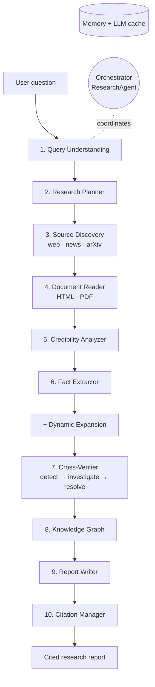

# 🔎 Autonomous Research & Intelligence Agent

A multi-agent system that turns a plain-English question into a **structured, cited research report**.
It plans the research, searches several source types, reads the documents, scores source credibility,
extracts facts, detects and resolves contradictions between sources, builds an evidence graph, and writes the report.

> Built for problem statement **PS-02: Autonomous Research Assistant** (Research & Knowledge).

---

## ✨ What it does

Instead of "search once → summarize", it runs a full research lifecycle:

```
Question → Understand → Plan → Search → Read → Score credibility → Extract facts
        → Cross-verify → Evidence graph → Report (with citations)
```

| Feature | Details |
|---|---|
| **Query understanding & planning** | Identifies topics and objectives, splits the question into 5–6 report sections with targeted search queries |
| **Source diversity** | Web + news (DuckDuckGo) and academic preprints (arXiv); PDFs and web pages are both read |
| **Credibility scoring** | Every source gets a 0–100 reliability score with a visible breakdown; weak sources are filtered out |
| **Fact extraction** | Facts, statistics and claims stored as structured data linked to their source |
| **Cross-verification** | Detects conflicting claims, searches for extra evidence, resolves with a verdict + confidence |
| **Evidence graph** | `topic → sections → facts → sources`, with agreements and contradictions marked |
| **Report generation** | Executive summary, background, findings, contradictions, analysis, conclusion, references |
| **Citation manager** | Numbered citations; every reference shows its reliability % |
| **Research memory** | Past investigations and per-URL facts are cached and reused |
| **Dynamic expansion** | Discovers subtopics in the evidence and researches them automatically |
| **Contradiction dashboard** | Side-by-side claims, credibility-weighted support, verdict, confidence |
| **Interactive mode** | Ask follow-ups or "expand section X" without restarting the research |

---

## 🏗️ Architecture



The "agents" are specialised steps, each with its own job and prompt, coordinated by one orchestrator class (`ResearchAgent`)
that passes a shared `Session` object between them. Searching, reading and credibility scoring are plain code;
planning, extraction, contradiction finding and writing use the LLM.

### Credibility model

A transparent heuristic, not a trained model:

| Source type | Base score |
|---|---|
| Government / standards body (e.g. NIST, CISA, EU) | 95 |
| Peer-reviewed publisher (Nature, IEEE, Springer…) | 92 |
| Government / academic domain (`.gov`, `.edu`, `.ac.*`) | 88 |
| Established news | 82 |
| Industry / research firm | 76 |
| arXiv preprint | 72 |
| Wikipedia / `.org` | 58 |
| Unknown domain | 48 |
| Blogs / social / user-generated | 30 |

Adjustments: HTTPS (+2), recency (+3 recent / −8 old), full text read (+3), thin content (−10).
Sources below the threshold (default 40) are dropped.

---

## 🧰 Tech stack

- **LLM:** [Groq](https://console.groq.com) API (default `openai/gpt-oss-120b`, automatic fallback to other Groq models)
- **Search:** DuckDuckGo (`ddgs`) and the arXiv API — no keys needed
- **Reading:** `requests`, `trafilatura` (HTML), `pypdf` (PDF)
- **Graph / tables / plots:** `networkx`, `pandas`, `matplotlib`
- **UI:** Streamlit

No dataset is required: the agent gathers its data live from the web.

---

## 📁 Repository structure

```
.
├── research_agent.py   # all agents + orchestrator (shared by notebook and app)
├── app.py              # Streamlit interface
├── Colab.ipynb         # step-by-step notebook (also writes the two files above)
├── requirements.txt
└── README.md
```

---

## 🚀 Getting started

### Get a Groq API key
Create a free key at <https://console.groq.com/keys>. **Never commit it to GitHub.**

### Option A — Google Colab
1. Upload `Colab.ipynb` to Colab.
2. Add the key under 🔑 **Secrets** as `GROQ_API_KEY` and enable notebook access
   (or paste it when Step 2 asks).
3. Run the cells top to bottom. Change `QUERY` in Step 4 to your question.
4. The last cells write `app.py` and launch Streamlit through a public tunnel.

### Option B — Run locally
```bash
git clone <your-repo-url>
cd <your-repo>
pip install -r requirements.txt

export GROQ_API_KEY="your_key_here"      # Windows PowerShell: $env:GROQ_API_KEY="your_key_here"
streamlit run app.py
```
You can also paste the key into the app's sidebar instead of setting the variable.

### Use it as a Python library
```python
import research_agent as ra

agent = ra.ResearchAgent(max_sources=10, max_contradictions=2)
session = agent.run("How will quantum computing impact cybersecurity over the next 10 years?")

print(session.report)                            # markdown report with citations
ra.contradiction_table(session)                  # contradiction dashboard (DataFrame)
ra.sources_table(session)                        # sources + reliability scores
ra.draw_graph(session)                           # evidence graph (matplotlib figure)

agent.ask("Explain the impact on RSA in more detail", session)   # follow-up, no restart
agent.expand_section("Post-Quantum", session)                    # deeper dive on a section
```

---

## ⚙️ Configuration

`ResearchAgent(...)` options:

| Parameter | Default | Meaning |
|---|---|---|
| `max_sources` | 16 | Cap on sources kept (expansion and contradiction checks may add more) |
| `min_credibility` | 40 | Sources scoring below this are filtered out |
| `max_contradictions` | 3 | How many contradictions to investigate further |
| `expand_topics` | `True` | Auto-discover and research extra subtopics |
| `fast_model` | `None` | Optional cheaper model for extraction only (e.g. `llama-3.1-8b-instant`) |
| `batch_size` | 3 | Documents per extraction call |

Environment variables: `GROQ_API_KEY`, `GROQ_MODEL`, `RESEARCH_MEMORY` (memory file), `RESEARCH_LLM_CACHE` (LLM cache file).

### Reducing API usage (Groq free tier)
Groq's free plan has per-model daily token limits, so the project includes:
- **LLM cache** (`llm_cache.json`): an identical prompt costs no API call
- **Batched extraction** (3 documents per call) and merged report calls
- **Low reasoning effort** for gpt-oss models on routine calls
- **Automatic model fallback** when a model's daily quota is exhausted
- Lower `max_sources`, `max_contradictions`, or `expand_topics=False` for lighter runs

---

## ⚠️ Limitations

- **Credibility is heuristic.** It rates the domain, not the individual article — a good post on a low-rated site is penalised, a weak page on a high-rated domain is rewarded.
- **Quality depends on retrieval and the LLM.** Results depend on what DuckDuckGo/arXiv return and on what the model extracts; the model can still misread or miss things. Always check the cited sources.
- **Publication dates can be wrong** when a page's metadata is wrong, which slightly skews the recency adjustment.
- **Contradiction detection** is LLM-based and may miss subtle conflicts or flag loose ones.
- **Free-tier limits.** Large runs can hit Groq rate or daily limits; the cache and fallback reduce but don't eliminate this.
- Some sites block scraping; those fall back to the search snippet.
- The Colab public link (Cloudflare quick tunnel) stops working when the Colab runtime stops.

---

## 🔒 Notes

- Keep API keys out of the repo (`.gitignore` already excludes `.env`, secrets, caches and generated reports).
- Generated files (`llm_cache.json`, `research_memory.json`, `research_report.md`) are local runtime data.

## 📄 License

Add a license of your choice (e.g. MIT) before publishing.
